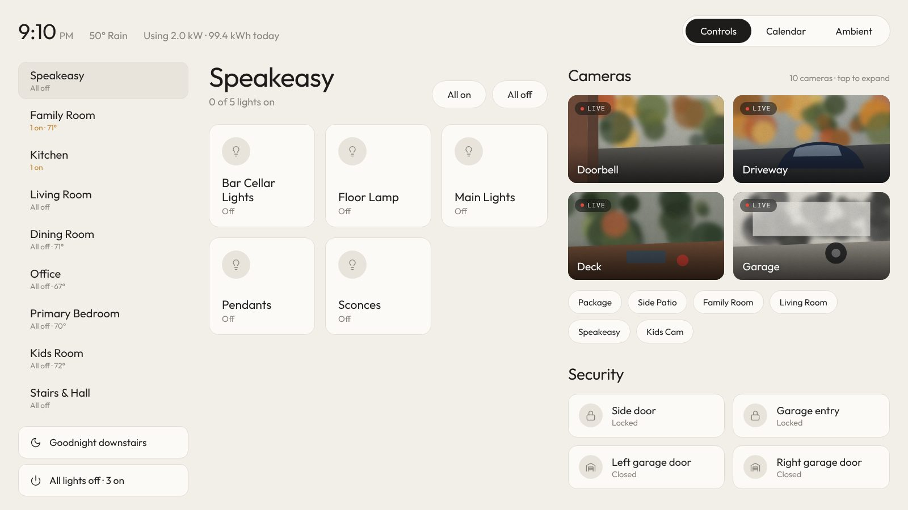
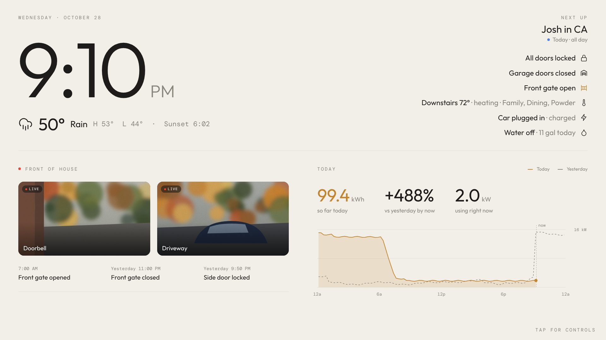
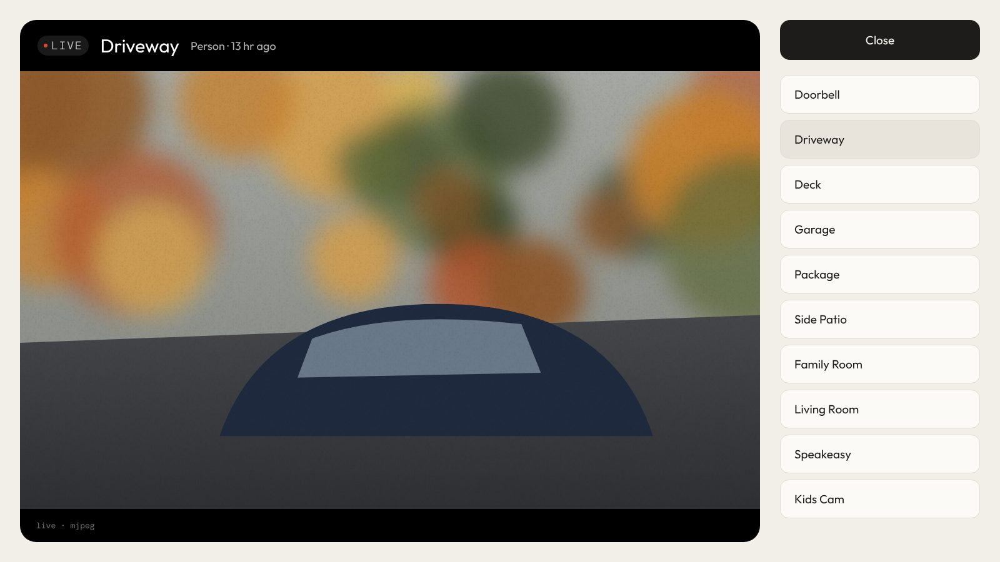
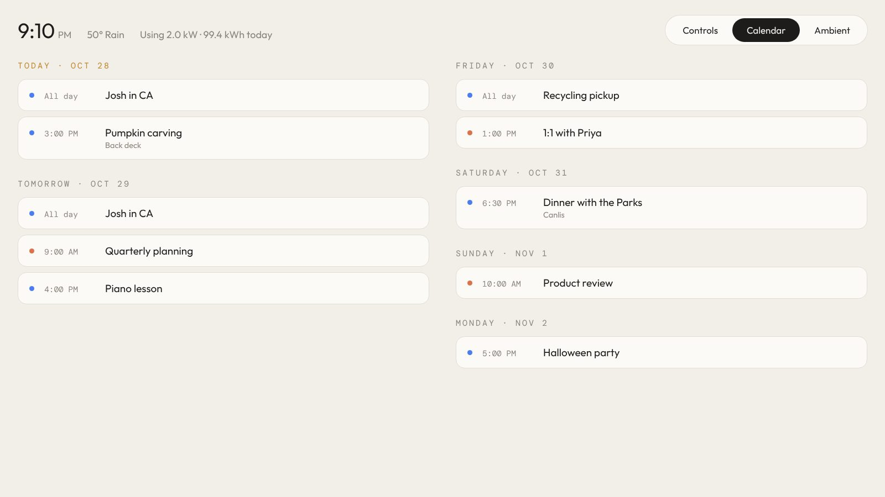
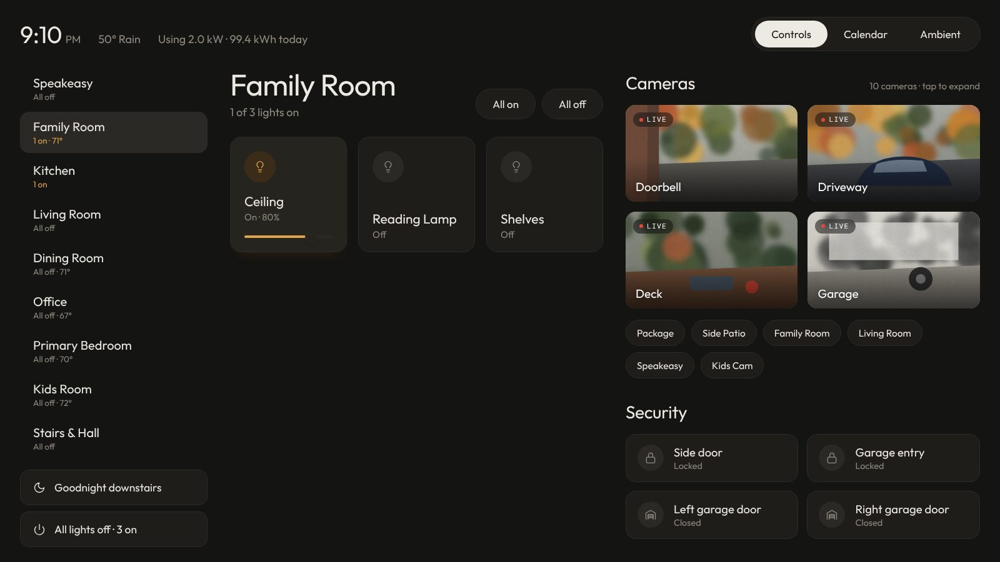

# Home Hub: a wall-panel interface for Home Assistant

A calm, typography-led home hub that runs **inside Home Assistant** as its own sidebar
panel. It has three views:

| Controls | Ambient |
| --- | --- |
|  |  |
| **Camera viewer** | **Calendar** |
|  |  |

- **Controls:**
  - Rooms come straight from your Home Assistant **Areas**. Each room shows its lights,
    temperature and an "x on" count.
  - Light tiles toggle on tap and have a brightness slider.
  - Each room has *All on* and *All off* buttons, and there are scene/script buttons under
    the room list.
  - The right column has live camera tiles and security tiles. Tapping a lock or cover
    asks you to confirm, and anything open or unlocked is highlighted in amber.
- **Ambient:**
  - A big clock with weather, high/low and sunset.
  - "Next up" from your calendar, and a house status column: locks, garage, gate,
    climate, EV, water.
  - Front-of-house cameras and recent door/lock activity.
  - Today's energy use with a chart comparing today to yesterday.
  - It switches to Ambient automatically after a few idle minutes. Tap anywhere to go
    back to Controls.
- **Calendar:** a two-week agenda across your calendars.
- **Camera viewer:** full-screen live view (HLS with sound, or MJPEG) with a list to
  switch cameras. If you have a detection sensor it shows something like
  "Person · 13 hr ago".

It adapts from a wall tablet down to a phone, and has a light and a dark theme
(`theme: auto` follows Home Assistant's theme).



## Install on your Home Assistant Green

1. **Get access to your config folder.** In Home Assistant: Settings → Add-ons → Add-on store →
   install **Studio Code Server** or **File editor**. *Samba share* also works if you'd rather
   copy files from your computer.
2. **Copy the panel file.** Create the folder `/config/www/home-hub/` and put
   [`home-hub.js`](home-hub.js) in it.
   *If `www` didn't exist before, restart Home Assistant once so it starts serving that folder.*
3. **Register the panel.** Open `/config/configuration.yaml` and paste in the `panel_custom:`
   block from [`panel_custom.example.yaml`](panel_custom.example.yaml). Start with only the
   first few lines (name, url_path, sidebar, module_url). Everything else is optional.
4. **Restart.** Developer tools → YAML → *Check configuration*, then Settings → System →
   Restart.
5. **Home Hub** now appears in the sidebar at `http://homeassistant.local:8123/home-hub`.

> **Updating:** after replacing `home-hub.js`, change `?v=1` in `module_url` to `?v=2` and
> restart so browsers load the new file.

### Make your rooms show up

Rooms are built from **Areas**. Go to Settings → Areas, labels & zones, and assign each light
(or its device) to a room. Names are tidied automatically: inside the Kitchen room a light
called "Kitchen Pendants" shows as **Pendants**. Light groups are skipped so they don't
double count.

### On a wall tablet

- Install the **Home Assistant Companion app**, or **Fully Kiosk Browser** on Android, and open
  `/home-hub`.
- Hide the HA sidebar on that device: click your profile → turn on *Always hide the sidebar*.
- Set `idle_minutes` so the panel falls back to Ambient when nobody's using it.

## What each part needs

| Feature | Needs |
| --- | --- |
| Weather, high/low, sunset | A `weather.*` entity, created during onboarding, and `sun.sun` |
| Energy numbers and chart | `power:` (W or kW) and `energy_today:` (kWh that resets daily; see the `utility_meter` snippet in the example). The chart uses the recorder's long-term statistics, so the power sensor needs `state_class: measurement` (most do) |
| "vs yesterday by now" | `energy_today:` with at least a day of history |
| Cameras | Any `camera.*`. UniFi Protect, Reolink, Ring and others all work. Live view uses HLS when the camera supports streaming, otherwise MJPEG |
| Person detection label | A `binary_sensor` per camera, e.g. UniFi Protect's `binary_sensor.<camera>_person_detected` |
| Calendar and Next up | Any `calendar.*`: Google Calendar, CalDAV/iCloud, or Local Calendar. Sports schedules work as ICS calendars |
| Recent activity | The logbook, which is on by default |

With **no config at all**, the panel still works:
- Rooms come from Areas.
- Cameras, locks and garage/gate covers are found automatically.
- Status shows locks, garage and climate.

## Config reference

Everything goes under `config:` in the `panel_custom` entry.

| Key | Default | What it does |
| --- | --- | --- |
| `theme` | `light` | `light`, `dark` or `auto` |
| `clock_24h` | `false` | 24-hour clock |
| `idle_minutes` | `5` | Minutes before switching to Ambient (`0` = never) |
| `default_view` | `controls` | `controls`, `calendar` or `ambient` |
| `camera_refresh` | `5` | Seconds between camera tile snapshots |
| `weather` | first `weather.*` | Weather entity |
| `power`, `energy_today` | none | Energy sensors |
| `rooms` | all areas with lights | Area names or ids, in display order |
| `hidden_rooms` | `[]` | Areas to hide |
| `room_domains` | `[light]` | Add `switch` or `fan` to show those as tiles too |
| `name_strip_area` | `true` | "Kitchen Pendants" → "Pendants" |
| `actions` | `[]` | `{name, icon, entity, confirm}` buttons for scenes, scripts or buttons |
| `cameras` | all cameras | `{entity, name, featured, detection, detection_label}` |
| `security` | locks + garage/gate covers | Entities or `{entity, name, icon}` |
| `status` | locks, garage, climate | Rows: `type: locks`, `type: garage`, `type: climate`, or any entity with `text`, `detail_entity`, `detail_suffix`, `icon`, `alert` |
| `activity` | security entities | Entities for the recent-activity strip |
| `calendars` | `[]` | Calendar view |
| `next_up_calendars` | `calendars` | Used for "Next up" |
| `highlight_calendars` | `[]` | Upcoming events shown as chips on Ambient |
| `calendar_colors` | auto | `{calendar.x: "#hex"}` |

Icons available for `icon:` are `bulb`, `lock`, `garage`, `gate`, `door`, `thermo`, `bolt`,
`drop`, `moon`, `power`, `car`, `fan`, `plug`, `scene`, `calendar`, `motion` and `shield`.

## Try it without Home Assistant

[`demo.html`](demo.html) runs the panel against a fake house so you can click around:

```bash
cd home-assistant/home-hub
python3 -m http.server 8000
# open http://localhost:8000/demo.html   (add ?view=ambient, ?view=calendar or ?theme=dark)
```

## Security notes

- The panel uses your normal Home Assistant login. No long-lived tokens are stored in files.
- Files in `/config/www` are served without login, so `home-hub.js` contains no secrets.
  Your entity config lives in `configuration.yaml`, which is not public.
- Fonts (Outfit, DM Mono) load from Google Fonts. In Chrome-based browsers, live video also
  loads `hls.js` from jsDelivr (Safari plays HLS natively). Without internet the panel falls
  back to system fonts and MJPEG video.
